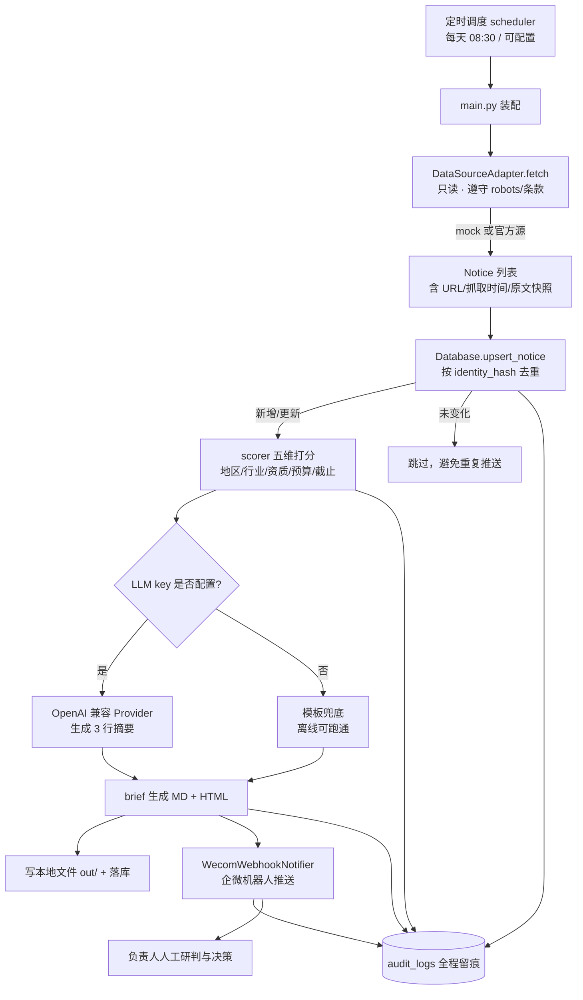

# 招投标机会监测工作台（第一阶段 · 只读 MVP）

每天定时从**合规公开数据源**抓取招标/采购公告，按公司资质打分筛选，生成可投项目简报并通过**企业微信机器人**推送给负责人。

> **本系统为只读监测系统**：不报名、不提交投标文件、不触碰 CA 锁/电子签章，任何对外业务动作必须人工二次确认。

公司画像（见 `config.yaml`）：主营大件运输、普货运输；资质：道路运输经营许可证；区域：徐州；行业词：运输/物流；预算区间：1–100 万（软性过滤）；负责人邮箱：703806798@qq.com。

---

## 一、合规红线（必须遵守）

1. **只使用官方开放接口、公共服务平台或已获授权的数据服务**；不绕过验证码、登录墙、频率限制；遵守目标站 `robots.txt` 与服务条款。
2. **每条数据保留来源 URL、抓取时间、原文快照**（`Notice.source_url / fetched_at / raw_snapshot`，落库到 `notices` 表）。
3. **系统不做自动报名、不自动提交投标文件**；任何对外动作必须人工二次确认（代码提供 `Pipeline.verify_manual_confirm()` 留痕入口，本阶段不触发任何对外动作）。
4. **不涉及 CA 锁、电子签章的任何自动化操作**。
5. **全程留痕**：采集日志、匹配理由、人工确认记录全部写入 `audit_logs` 表。

这些约束同时写在各模块文件头注释与 `fetch()` / `send()` 等关键方法处。

---

## 二、架构图（mermaid）



---

## 三、目录结构

```
bid-radar/
├── README.md                    # 本文档
├── .env.example                 # 环境变量模板（密钥走这里）
├── config.yaml                  # 公司画像、权重、调度、数据源、LLM/通知器开关
├── requirements.txt             # 依赖清单
├── run_once.py                  # ★ run-once 命令：一条命令跑通全流程
├── index.py                     # 腾讯云 SCF 定时触发入口
├── migrations/001_init.sql      # 初始建表迁移脚本
├── src/
│   ├── main.py                  # CLI 入口与组件装配
│   ├── config.py                # .env + config.yaml 加载与占位符替换
│   ├── models.py                # Notice / MatchResult / DimensionScore
│   ├── pipeline.py              # 主流程编排（只读）
│   ├── brief.py                 # Markdown + HTML 简报渲染
│   ├── adapters/
│   │   ├── base.py              # 数据源适配器抽象接口（合规说明）
│   │   └── mock_adapter.py      # mock 数据源（离线、覆盖边界样例）
│   ├── matcher/
│   │   ├── rules.py             # 五维规则函数（纯函数）
│   │   └── scorer.py            # 加权打分 0-100 + 理由 + 风险
│   ├── llm/
│   │   ├── base.py              # LLM Provider 接口
│   │   ├── factory.py           # 工厂：有 key 用 LLM，无 key 用模板
│   │   ├── openai_provider.py   # OpenAI 兼容实现（仅生成文案）
│   │   └── templates.py         # 模板兜底
│   ├── notifier/
│   │   ├── base.py              # Notifier 接口（合规说明）
│   │   └── wecom_notifier.py    # 企微机器人 webhook
│   ├── storage/
│   │   ├── db.py                # SQLite CRUD、去重 upsert、留痕
│   │   └── schema.sql           # 建表结构
│   └── scheduler.py             # 定时调度 + 失败重试
├── tests/
│   ├── test_scorer.py           # 打分逻辑单测
│   ├── test_mock_adapter.py     # mock 适配器集成测试
│   └── conftest.py
├── out/                         # run-once 产出的简报文件（md/html）
├── data/                        # SQLite 数据库
└── logs/                        # 运行日志
```

---

## 四、数据表结构（SQLite）

建表/迁移：`migrations/001_init.sql`（程序启动时也会自动执行 `src/storage/schema.sql`）。

| 表 | 关键字段 | 说明 |
|---|---|---|
| `notices` | `identity_hash`(唯一)、`content_hash`、`source_url`、`fetched_at`、`raw_snapshot`、`change_type(new/updated)`、`first_seen_at`、`last_seen_at` | 公告主表；**每条保留来源 URL / 抓取时间 / 原文快照**；按 `identity_hash` 去重，按 `content_hash` 判定更新 |
| `matches` | `notice_pk`、`score`、`dimensions_json`、`reasons_json`、`risks_json`、`summary`、`recommended` | 匹配分数、理由、风险提示、摘要 |
| `briefs` | `run_date`、`markdown`、`html`、`md_path`、`html_path`、`item_count` | 每日简报元数据 |
| `brief_items` | `brief_id`、`notice_pk`、`score`、`change_type` | 简报项目明细（新增/更新标记） |
| `audit_logs` | `ts`、`event`、`level`、`ref_id`、`message`、`detail_json` | **全程留痕**：fetch/match/brief/push/manual_confirm |

去重策略：`identity_hash = sha256(source + notice_id 或 url)`；内容变化用 `content_hash` 检测，标记「更新」，否则「未变化」跳过，保证**同一公告只推一次**。

---

## 五、快速开始（10 分钟）

环境：Python 3.11+（已在 3.13 验证）。

```powershell
# 1. 进入目录
cd bidding-monitor

# 2. 安装依赖
pip install -r requirements.txt

# 3. 复制环境变量模板（密钥留空也能跑通；留空时摘要走模板、企微不实际外发）
cp .env.example .env

# 4. ★ run-once：立即跑通全流程，在 out/ 输出简报
python run_once.py          # 只报今日新增/更新（每日增量）
python run_once.py --all    # 展示当前全部可投项目（看板/复盘/演示）

# 5. 运行测试（9 项，含打分单测 + mock 集成测试）
python -m pytest tests/ -q
```

`python run_once.py` 会输出类似：

```json
{
  "fetched": 6,
  "new_or_updated": 6,
  "recommended": 5,
  "markdown": ".../out/brief_20261119160019.md",
  "html": ".../out/brief_20261119160019.html",
  "pushed": false
}
```

第二次运行同一批公告会显示 `unchanged` 并跳过，验证增量去重。

### 接入真实 LLM（可选）

在 `.env` 填入：

```
LLM_MODEL=gpt-4o-mini
LLM_BASE_URL=https://api.openai.com/v1
LLM_API_KEY=sk-xxxxxxxx
```

有 key 时摘要由模型生成（失败自动降级模板）；无 key 时完全离线也能产出简报。

### 接入企微机器人（可选）

群设置 → 群机器人 → 添加 → 复制 Webhook 地址，填入 `.env`：

```
WECOM_WEBHOOK_URL=https://qyapi.weixin.qq.com/cgi-bin/webhook/send?key=xxxx
```

**留空时**（默认）只生成本地简报、不实际外发，符合只读 MVP 的安全默认。填入后 `run-once` / 定时任务会推送简报到群。

---

## 六、定时调度与部署

### 本地 / 服务器常驻（APScheduler）

```powershell
python -m src.main schedule
```

按 `config.yaml` 的 `schedule.cron_hour: 8` / `cron_minute: 30` 每天 08:30 运行，失败按指数退避重试 3 次，全过程写 `audit_logs`。

### crontab 示例（Linux 服务器）

```cron
# 每天 08:30（Asia/Shanghai）执行一次，日志追加
30 8 * * * cd /opt/bidding-monitor && /usr/bin/python3 run_once.py >> logs/cron.log 2>&1
```

### 云函数部署示例（腾讯云 SCF，Python 3.11）

1. 打包：将 `src/`、`config.yaml`、`index.py`、`requirements.txt` 一起上传。
2. 入口 `index.py`：

```python
# index.py —— 云函数入口（SCF handler）
from src.config import load_config
from src.main import cmd_run_once

def main_handler(event, context):
    cfg = load_config()
    result = cmd_run_once(cfg)
    return {"code": 0, "msg": "ok", "result": result}
```

3. 环境变量：在云函数控制台配置 `LLM_*`、`WECOM_WEBHOOK_URL`（**不要**写进代码包）。
4. 触发器：定时触发 `0 30 8 * * *`（cron 秒 分 时 日 月 周），时区选东八区。
5. 注意：云函数文件系统只读，需将 `out/`、`data/` 指向可写目录（如 `/tmp`）或改用云数据库；SQLite 在 SCF 下建议替换为托管数据库。

> 生产建议：定时任务保留轻量无状态特性，简报文件可改为对象存储；密钥统一走密钥管理服务（KMS）/环境变量。

---

## 七、如何新增数据源

1. 在 `src/adapters/` 新建 `xxx_adapter.py`，继承 `DataSourceAdapter`，实现 `fetch()` 返回 `list[Notice]`。
2. `fetch()` 内必须：只调用官方开放接口/授权服务；遵守 robots、服务条款、频率限制；不登录、不绕验证码；**只读**；每条 `Notice` 填好 `source_url`、`fetched_at`、`raw_snapshot`。
3. 在 `config.yaml` 的 `datasources` 增加条目，并在 `src/main.py::build_adapter` 注册类型映射。
4. 后续三个官方源接入建议（均已预留配置位）：
   - `ccgp`：中国政府采购网（ccgp.gov.cn），字段结构化、全国覆盖；
   - `ggzy_js`：江苏/徐州公共资源交易平台，区域匹配度最高；
   - `cebpubservice`：中国招标投标公共服务平台（cebpubservice.com）。
   - **接入前须核验 robots/服务条款；若无开放 API 且站内限制严格，优先使用其官方数据服务或授权数据商，不绕过任何访问限制。**

---

## 八、评分规则说明

五维加权总分 100（权重见 `config.yaml`）：

| 维度 | 规则 |
|---|---|
| 地区 | 命中目标城市满分；仅命中省份部分分并提示；异地 0 分 |
| 行业关键词 | 标题/资质含「运输/物流」满分；否则 0 分并提示 |
| 资质 | 命中公司持有资质满分；含公司未持有的特殊许可（危货/等级资质等）扣分并提示**资质缺项** |
| 预算 | 1–100 万满分；**软性过滤**：区间外扣分 + 风险提示，但保留在简报中 |
| 截止时间 | 未过期按紧迫度给分；已过期 0 分并提示不可投 |

`score ≥ recommend_threshold(55)` 进入推荐简报，按分数降序展示，标注「新增/更新」、截止倒计时、原文链接、3 行摘要、匹配理由与风险提示。

---

## 九、合规声明

本仓库所有代码仅用于**公开招标信息的只读监测与内部决策辅助**。系统不包含任何报名、投标提交、CA 锁、电子签章的自动化逻辑。使用者须自行确保所用数据源合法合规，并遵守目标网站的 robots 与服务条款。

---

## 十、当前状态与入口

- [x] 阶段 0：仓库初始化（GitHub: duanguopei123/bid-radar）
- [x] 阶段 1：CodeBuddy 生成 MVP 初版（已由 bidding-monitor 目录并入本仓库 bid-radar）
- [x] 阶段 2：代码审查把关（**47 项测试全部通过**；先修 8 处缺陷，再按 TDD 修完「静默失败」整类问题，见下方记录）
- [x] 阶段 3：生态补强（**微信推送 Server酱 / PushPlus 已接入**、响应式邮件模板含倒计时配色、SCF 入口 `index.py` 已就绪）
- [x] 桌面设置软件：`配置工作台.bat`（换公司/换行业/配推送，见 `换公司-换行业操作指南.md`）
- [ ] 阶段 4：人工验收

**双击入口**：

| 文件 | 作用 |
|---|---|
| `配置工作台.bat` | 打开设置软件：改公司信息、配微信推送、设每天 9 点 |
| `启动工作台.bat` | 立刻跑一次（全量视图）并用浏览器打开最新简报 |
| `自检.bat` | 一次查完环境/公司信息/推送渠道/定时任务/最近运行，告诉你哪里没配好 |
| `运行测试.bat` | 跑全部测试，结果同时写入 `test_output.txt` |
| `每日推送.bat` | 静默运行，供 Windows 计划任务调用（无窗口、结果写 logs） |

**项目位置**：`C:\Users\ZJ\WorkBuddy\2026-11-19-14-31-48\bid-radar`

### 推送渠道（每日 9:00 到手机微信）

| channel | 渠道 | 门槛 | 免费额度 |
|---|---|---|---|
| `none` | 不外发，只落盘 | 无 | — |
| `serverchan` | 微信 · Server酱 | 扫码登录，无需实名 | 5 条/天 |
| `pushplus` | 微信 · PushPlus | 扫码 + 实名 | 200 条/天 |
| `wecom_webhook` | 企业微信群机器人 | 需企业微信 | 无限 |

Token 只存 `.env`（`SERVERCHAN_SENDKEY` / `PUSHPLUS_TOKEN` / `WECOM_WEBHOOK_URL`），
`config.yaml` 里只有 `${VAR:-}` 占位符，任何时候都不出现明文。
推送内容是手机端短摘要（`render_push_summary`）：日期 + 可投数量 + 每条项目一行 + 原文链接；
完整简报仍在 `out/` 的 HTML 里。

### 阶段 2 审查修复记录（8 处）

| # | 问题 | 修复 |
|---|------|------|
| 1 | 地区判断用字符长度区分省/市，「江苏省」被当作城市给满分 | 改为按「省/自治区/特别行政区」后缀判断，城市命中优先 |
| 2 | 推送失败会中断整个流程，已生成的简报拿不到结果 | try/except 包裹，失败留痕但不中断 |
| 3 | 采集异常直接崩溃且无留痕 | 记录 ERROR 审计后抛出，便于调度器重试 |
| 4 | 简报日期用本机时间、审计日志用 UTC，跨天会错位 | 统一按 config 的 `Asia/Shanghai` 取时间 |
| 5 | 预算 0 被当作「低于下限」，摘要显示「未披露」，前后矛盾 | 0 与 None 统一视为未披露 |
| 6 | 资质匹配写死了「道路运输经营许可证」特例 | 改为「全名 + 去后缀核心词」通用匹配 |
| 7 | notice_id 与 source_url 同时为空时，所有公告撞同一去重键 | 增加「标题+采购人」兜底 |
| 8 | 第二次运行必出空简报，双击入口像坏了 | 新增 `--all` 全量视图，双击默认使用 |

配套新增 `tests/test_rules_edge.py`（6 个回归测试），总计 15 项测试。

### 阶段 2（第二轮）静默失败类修复记录（11 处，TDD 驱动）

先写 11 个必然失败的测试（`tests/test_runtime_safety.py`），再改代码让它们转绿，共 27 项。
之后新增 10 个推送通道测试（`tests/test_notifier_channels.py`）；再加 7 个时间展示测试与 3 个自检测试，总计 **47 项**。

| 问题 | 后果 | 修复 |
|---|---|---|
| 评分异常被吞，公告被标记为已处理 | 该公告永久不再重试 | `notice_processing` 状态表 + 每日重试 pending/failed |
| 推送失败后不补发 | 当天简报永久丢失 | `brief_deliveries` 状态机，失败保留待重试 |
| 单条公告异常中断整批 | 当天其余公告全丢 | 单条 try/except 隔离，计入 `failed` 继续 |
| 业务日期取两次 | 午夜跨天时 run_id 与 run_date 不一致 | run() 开头只取一次 `business_date` 并向下传递 |
| Adapter 名字拼错静默回退 Mock | 看到假数据却毫无提示 | 抛带名称的 `ValueError` |
| `--config` 参数被忽略 | 指定配置文件不生效 | 透传给 `load_config()` |
| SCF 把去重库放 `/tmp` | 冷启动丢状态，天天重复推 | 必须显式提供 `BID_RADAR_DB_PATH` |
| 调度器重试耗尽静默 return | APScheduler 以为成功，实际连续失败 | 重新抛出最后一次异常 |
| 入口失败仍返回 0 | 计划任务看不出失败 | `run_once.py` / `index.py` 返回非零 |
| 过期项目仍被推荐 | 推的是投不了的项目 | 只翻转 `recommended`，分数与维度不变 |
| bat 失败时打开旧简报 | 误以为今天有结果 | 失败即停、`pause`、不打开旧简报 |
